# RevisionHub

Engineering change control for parts, revisions and multi-level bills of materials.

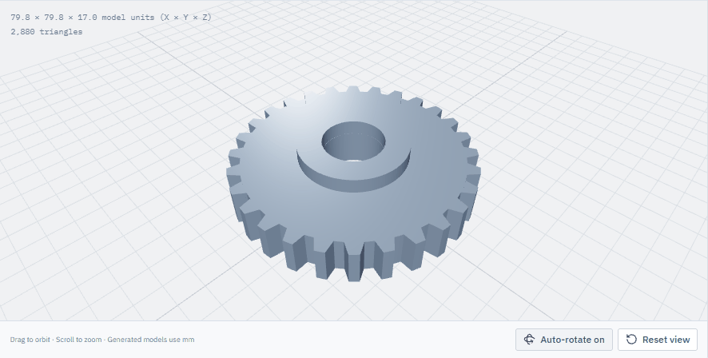

## Why this project

A drawing revision changes more than a file name. It changes the parts a team builds, the quantities it buys, and the evidence it needs before release. RevisionHub puts those records together: identify the part, inspect its structure, compare the proposal, record the review, and release the approved revision.

The workspace follows an engineering register: compact tables, persistent sidebar navigation, IBM Plex Sans for reading, IBM Plex Mono for identifiers, flat surfaces and a single blue accent. The first dashboard view is the user's ECR queue. Counts and charts support that work.

## Features

- **Part and revision register.** Search component and assembly numbers, create sequential revisions, and follow Draft, In Review, Released and Obsolete states.
- **Multi-level BOMs.** Expand and collapse indented structures, edit direct children on drafts, validate positive quantities, reject circular structures, and export CSV with per-parent and effective quantities.
- **Revision comparison.** A code-review-style diff separates added parts, removed parts, quantity changes and child revision substitutions. Every effective quantity retains its assembly paths.
- **Engineering change requests.** Engineers propose and submit changes. Independent reviewers record their decisions. Approvers release accepted changes atomically, obsoleting the previous release. Rejections require comments and unlock the draft for rework.
- **Role-specific inboxes and activity.** Each role sees actionable requests. Audit records connect parts, BOM edits, state transitions, decisions and attachments. The dashboard measures first-submission-to-release time.
- **Supporting files and 3D inspection.** Attach STL, STEP, PDF, PNG and JPG files to drafts. Inspect STL geometry with orbit, zoom, auto-rotation, reset, bounding dimensions and triangle counts. Images preview inline; other formats remain downloadable.
- **Reproducible engineering catalogue.** A city bicycle and a gearbox share realistic fasteners, bearings and subassemblies. Dated ECR histories cover draft work, pending review, review passed, rejection and release. Repeated seeding preserves existing edits and decisions.

## Screenshots

| Engineering overview | BOM tree |
| --- | --- |
| 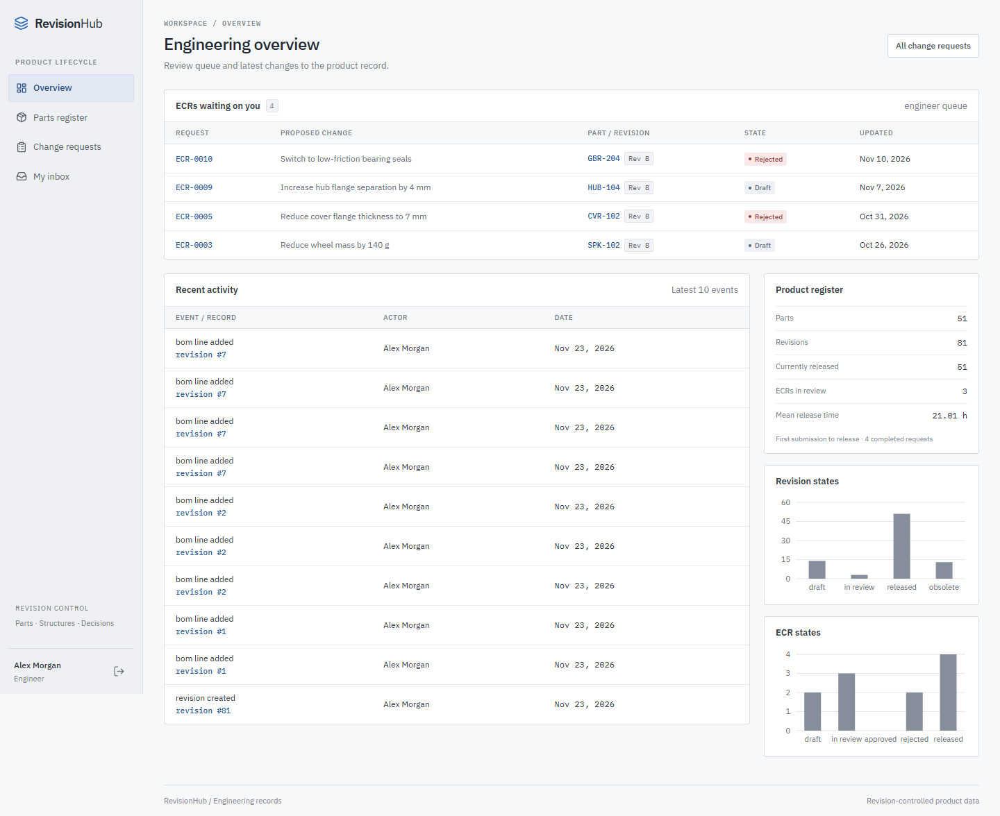 | 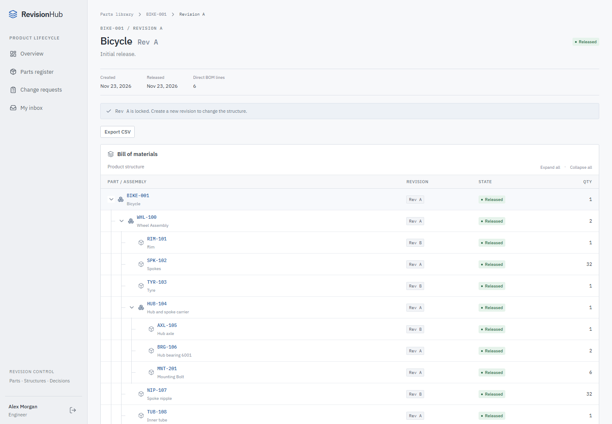 |

| Revision comparison | ECR detail |
| --- | --- |
| 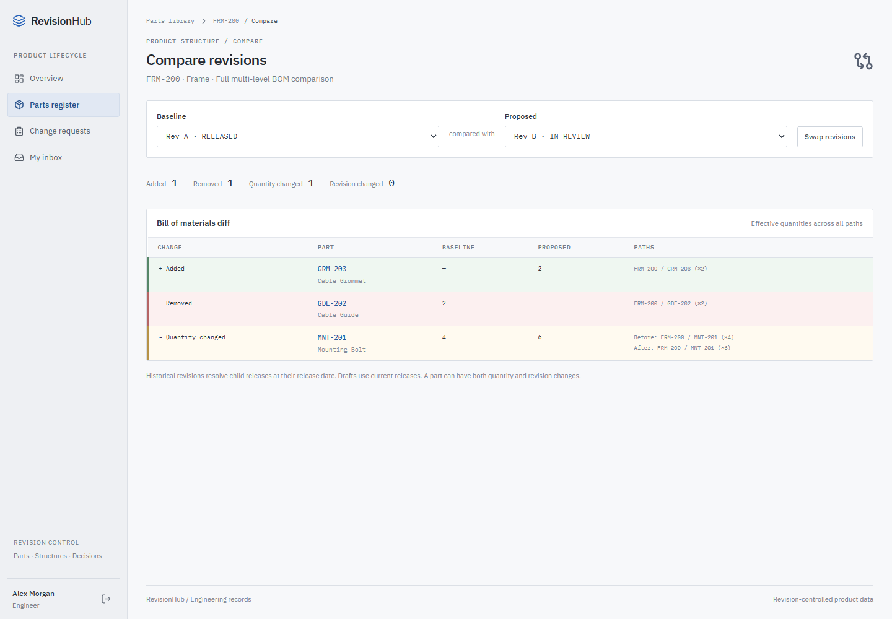 | 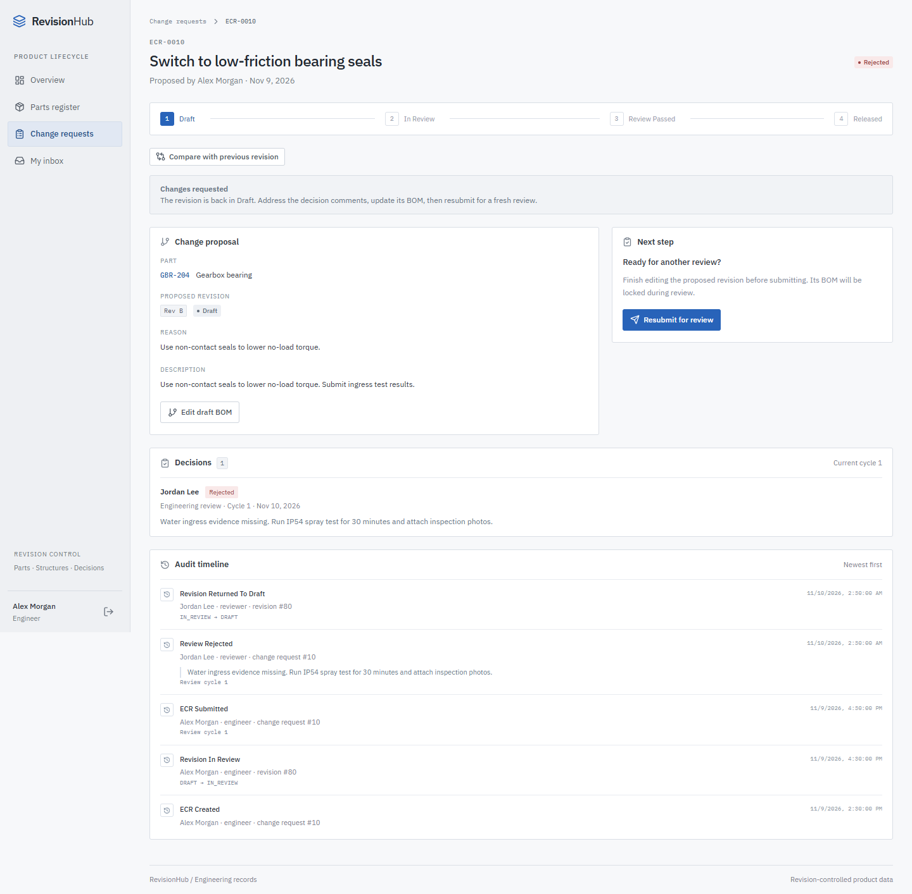 |

| Inspection flange | Slotted brake rotor | Bicycle rim |
| --- | --- | --- |
| 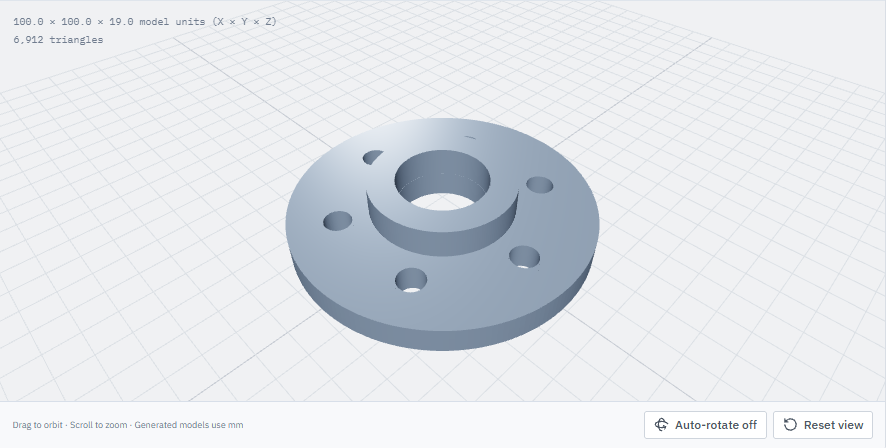 | 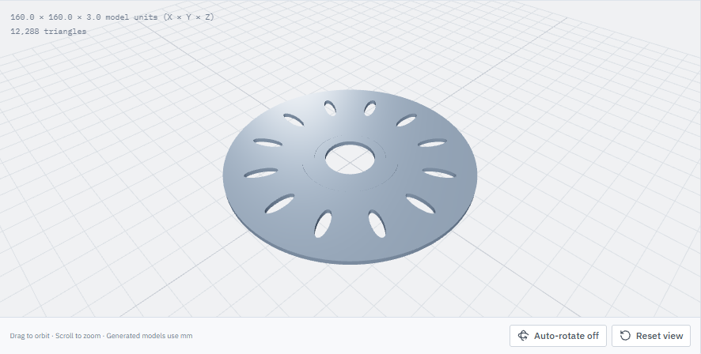 | 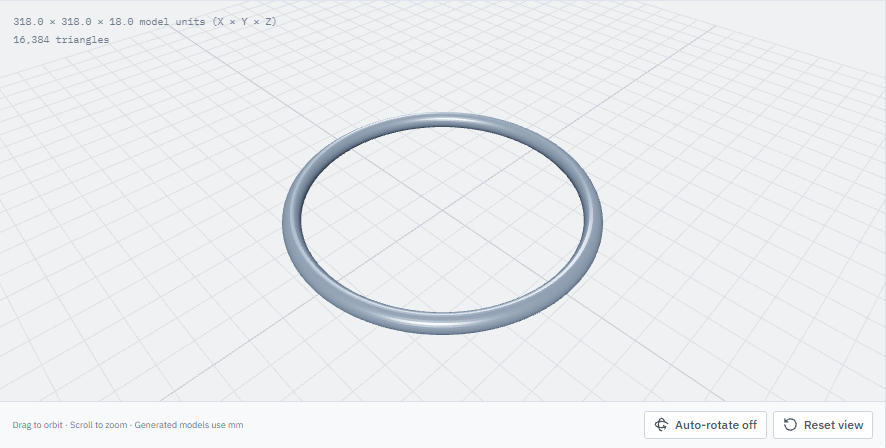 |

The rotating gear viewer is shown above. [Capture instructions and image index](docs/screenshots/README.md) describe how to rebuild the gallery.

<details>
<summary>Original project captures</summary>

These three images are retained as the original visual record.

| Dashboard | Comparison | STL viewer |
| --- | --- | --- |
| 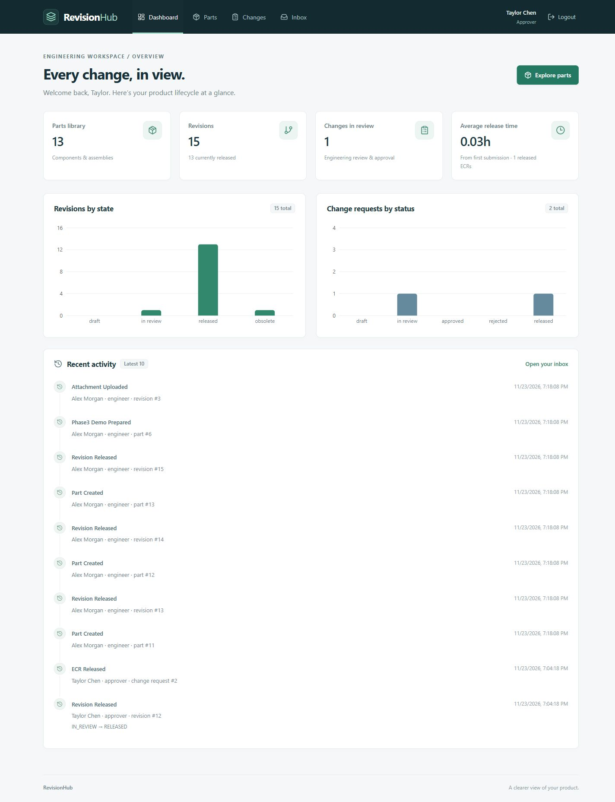 | 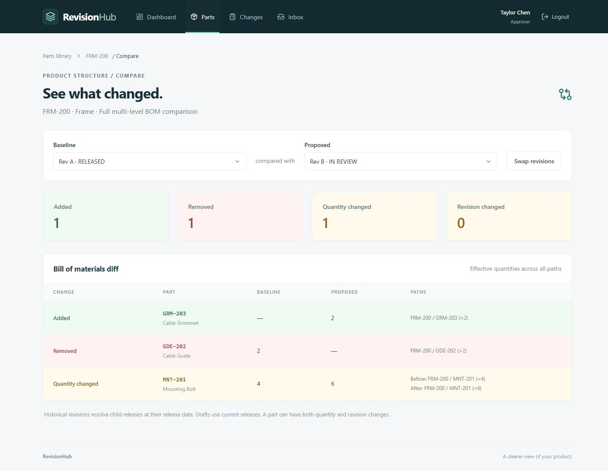 | 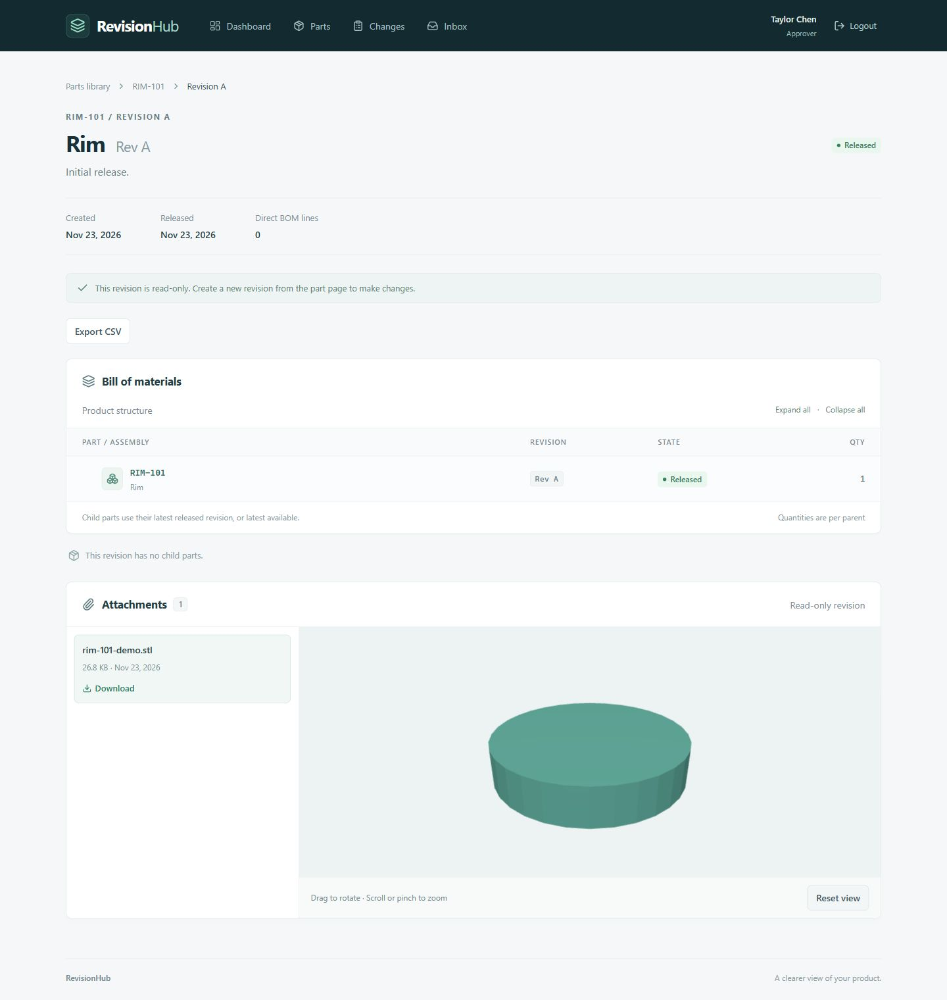 |

</details>

## By the numbers

Measured from a **fresh seeded SQLite database** on 23 November 2026. The benchmark seeds it twice and compares complete database rows before sending requests. An existing workspace can contain additional user records.

<!-- metrics:start -->
| Measure | Result |
| --- | ---: |
| Parts | 51 |
| Revisions | 81 |
| Direct BOM lines across all revisions | 119 |
| Engineering change requests | 10 |
| API endpoints (method + path in OpenAPI) | 26 |
| Automated tests | 8 |
| Backend source lines | 1,705 |
| Frontend source lines | 1,047 |
| Deepest BOM | 3 child levels / 4 tiers including the product |
| Generated 3D model designs | 8 |
| Parts with released 3D attachments | 15 |

| Local API route | Requests | p50 | p95 |
| --- | ---: | ---: | ---: |
| BOM tree | 200 | 9.98 ms | 18.21 ms |
| Revision compare | 200 | 14.78 ms | 32.52 ms |
| Dashboard | 200 | 10.26 ms | 17.79 ms |
<!-- metrics:end -->

Timings use real HTTP/1.1 requests over loopback, one persistent client, sequential requests, and ten warmups per route. They include authentication, database queries and response serialization. The BOM and comparison routes use the gearbox structure and its A/B revisions. Percentiles describe this local dataset and machine, rather than a concurrency/load target.

Source counts are physical lines, including blanks and comments: Python under `backend/` excluding tests/caches, and TypeScript/TSX/CSS under `frontend/src/`. Generated assets, dependencies and scripts are excluded. [Raw results](docs/benchmark.json) contain the exact route IDs, environment and measurements.

Rerun from the repository root with backend dependencies installed:

```sh
python scripts/benchmark.py --fresh-seed --update-readme
```

This uses an isolated database under `.local/`, starts a temporary API on port 8001, verifies seed idempotency, measures 200 requests **per route**, writes `docs/benchmark.json`, refreshes the tables above, and stops its API process. To measure a running workspace instead:

```sh
python scripts/benchmark.py --base-url http://127.0.0.1:8000 --requests 200
```

## Architecture

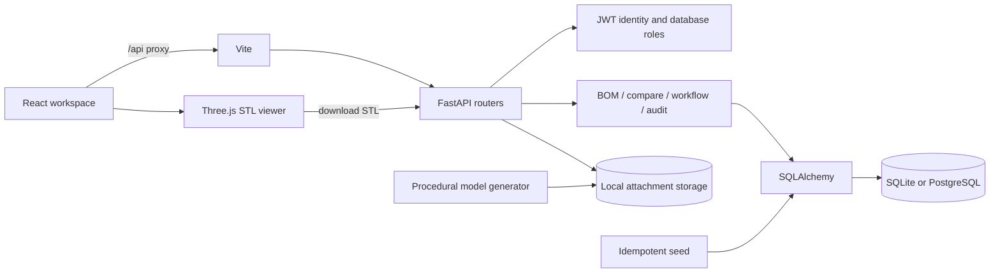

Routers own HTTP validation and transaction boundaries. Service modules handle graph traversal, revision selection, comparison and state transitions. Workflow changes, decisions, audit events and release/obsolescence commit together. Attachments store metadata in the database and bytes in `backend/uploads/`.

```text
backend/
  app/routers/       HTTP endpoints
  app/services/      BOM, compare, workflow, revisions and audit
  app/models.py      SQLAlchemy entities and constraints
  app/schemas.py     API validation and response schemas
  seed.py            Versioned bicycle and gearbox catalogue
  tests/             Eight regression tests
frontend/src/
  pages/             Workspace routes
  components/        BOM tree, diff helpers, attachments and STL viewer
  styles.css         Tailwind and engineering workspace styles
scripts/
  generate_models.py Standard-library binary STL generator
  benchmark.py       Counts, source metrics and HTTP latency
  capture_showcase.py Playwright screenshots and Pillow animation
```

## ER diagram

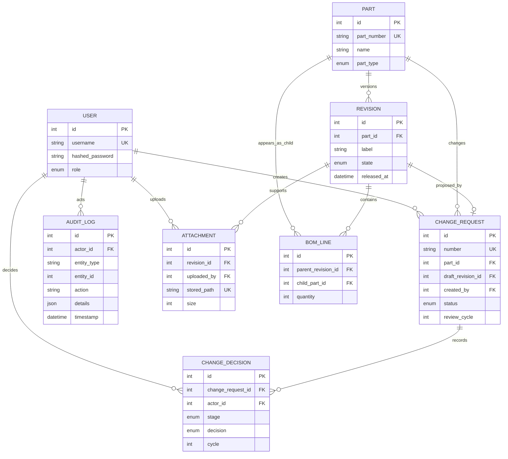

Part numbers are unique. Revision labels are unique within a part. A parent revision can reference each child part once. Quantities must be positive. Each proposed revision belongs to at most one ECR, and each review cycle permits one decision per stage. Audit entity references are polymorphic (`entity_type` + `entity_id`).

## ECR workflow

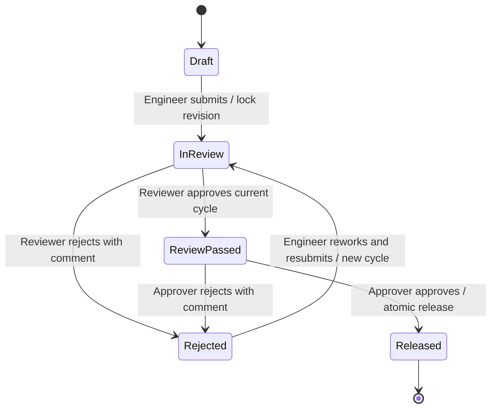

**Review passed** is derived from the current cycle's reviewer decision; the ECR remains `IN_REVIEW` while awaiting final approval. Final approval passes through `APPROVED` and immediately reaches `RELEASED` in the same transaction. A rejected revision returns to `DRAFT`. A released revision is read-only; a subsequent release makes its predecessor `OBSOLETE`.

## Tech stack

| Layer | Technology |
| --- | --- |
| Workspace | React 19, TypeScript, React Router, Vite |
| Styling | Tailwind CSS 4, IBM Plex Sans / Mono, Lucide |
| Charts and 3D | Recharts, Three.js, STLLoader, OrbitControls |
| API | FastAPI, Pydantic, Uvicorn |
| Persistence | SQLAlchemy 2, SQLite locally, PostgreSQL via psycopg |
| Identity | bcrypt password hashes, expiring HS256 JWTs |
| Verification | pytest, HTTPX, Playwright, Pillow |
| Geometry | Python standard library: math and struct, binary STL |

## Roles and demo logins

All three demo accounts use **`password123`**.

| Username | Person | Role and workflow responsibility |
| --- | --- | --- |
| `engineer1` | Alex Morgan | Prepare and submit ECRs; rework rejected proposals |
| `reviewer1` | Jordan Lee | Review submitted changes and record technical decisions |
| `approver1` | Taylor Chen | Approve reviewed changes and release the revision |

The creator cannot review or approve their own ECR. Role checks use the current database user. Any signed-in account can use the existing part, revision and draft BOM/attachment editing endpoints; ECR decisions enforce the role separation above.

A useful tour: inspect `BIKE-001`, compare `FRM-200` A/B, open a rejected cover-flange ECR, sign in as the approver to see the reviewed gear proposal, then open `GER-201`'s released revision to rotate the model.

## Run locally

Requires Python 3.12+ and Node.js 22+.

From the repository root, on Windows PowerShell:

```powershell
python -m venv .venv
.venv\Scripts\python -m pip install -r backend\requirements.txt
.venv\Scripts\python backend\seed.py
.venv\Scripts\python -m uvicorn app.main:app --app-dir backend --reload
```

In another terminal:

```powershell
cd frontend
npm ci
npm run dev
```

On macOS/Linux, use `.venv/bin/python` in place of `.venv\Scripts\python`. Open [RevisionHub](http://localhost:5173) and [interactive API docs](http://localhost:8000/docs). Vite proxies `/api` to port 8000.

The default database is `backend/revisionhub.db`. Set `DATABASE_URL` for another SQLite file or PostgreSQL database. Set `SECRET_KEY` for a shared deployment signing key; local development creates a persistent random key in `backend/.jwt-secret`. Back up the database and uploads together.

### Seed and model generation

```sh
python backend/seed.py
python backend/seed.py
python scripts/generate_models.py
```

Seeding creates missing catalogue records once, guarded by a versioned audit marker, and preserves subsequent user edits, deleted BOM lines and completed ECR workflows. Model files are deterministic and missing attachment bytes are repaired on rerun. Each fresh catalogue has 51 parts, 81 revisions, 119 BOM lines and 10 ECRs. Existing workspaces retain their previous records.

Eight mesh designs cover a toothed spur gear with a bore, a drilled flange, a toroidal rim, a hub with spokes, a chamfered bracket, a two-ring bearing, a slotted rotor and a hex-head bolt. Curves use up to 256 circumferential segments. The generator writes outward-facing normals and dimensions in millimetres. The viewer reports original STL bounding-box units because STL files do not encode a unit system.

### Verify and regenerate the showcase

```sh
cd backend
python -m pytest -q
cd ../frontend
npm run build
cd ..
python -m pip install -r scripts/requirements.txt
python -m playwright install chromium
python scripts/capture_showcase.py
python scripts/benchmark.py --fresh-seed --update-readme
```

The eight backend tests cover creation, BOM expansion/cycle rejection, review and release rules, rejection/resubmission, comparison and CSV export. The browser capture script checks desktop routes, search, BOM expansion, role-specific queues, mobile overflow and viewer controls, and writes additional captures plus a runtime-error report under `.local/browser-qa/`.

## Run with Docker

```sh
docker compose up --build -d
docker compose exec backend python seed.py
```

Open [RevisionHub](http://localhost:5173). Compose runs PostgreSQL, FastAPI and Vite, with named volumes for database records and attachments.

## API overview

All application routes use the `/api` prefix. [Swagger UI](http://localhost:8000/docs) and [OpenAPI JSON](http://localhost:8000/openapi.json) describe every schema and operation.

| Area | Representative endpoints |
| --- | --- |
| Session | `POST /auth/login`, `GET /auth/me` |
| Parts | `GET/POST /parts`, `GET /parts/{id}`, `POST /parts/{id}/revisions` |
| Revisions and BOM | `GET /revisions/{id}`, `GET /revisions/{id}/bom-tree`, `POST /revisions/{id}/bom`, `DELETE /revisions/{id}/bom/{line_id}` |
| Compare and export | `GET /revisions/{id}/compare/{other_id}`, `GET /revisions/{id}/bom.csv` |
| Change requests | `GET/POST /changes`, `GET /changes/{id}`, `POST /changes/{id}/submit`, `POST /changes/{id}/review`, `POST /changes/{id}/approve` |
| Audit and overview | `GET /audit`, `GET /parts/{id}/audit`, `GET /dashboard` |
| Attachments | `GET/POST /revisions/{id}/attachments`, `GET /attachments/{id}/download`, `DELETE /attachments/{id}` |
| Health | `GET /health` |

Authenticated requests send `Authorization: Bearer <token>`. Write operations require authentication; ECR, audit and dashboard reads also require a session. Part, revision and attachment reads are public in the demo. Attachment uploads are limited to 20 MiB and draft revisions.

## Documentation

- [Requirements and acceptance criteria](docs/REQUIREMENTS.md)
- [Use cases and workflow walkthroughs](docs/USE_CASES.md)
- [Troubleshooting](docs/TROUBLESHOOTING.md)
- [Screenshots and capture instructions](docs/screenshots/README.md)
- [Measured benchmark output](docs/benchmark.json)
- [Model generator](scripts/generate_models.py), [benchmark](scripts/benchmark.py), [browser capture](scripts/capture_showcase.py)

## Limitations and future work

- **Frozen manufacturing baselines.** BOM lines reference child parts. The interactive tree and CSV resolve current released children, falling back to the latest available revision. Compare resolves historical children at the root's release time, with a fallback for imported records. Pinned child revisions and immutable release snapshots would make manufacturing baselines fully reproducible.
- **CAD scope.** Procedural STL meshes demonstrate inspection; they are representative display geometry rather than production drawings or validated gear profiles. STEP and PDF files download without native 3D/document rendering. Future work includes STEP tessellation, section planes and measurement tools.
- **Deployment boundaries.** Public demo reads, local file storage and fixed roles fit a small installation. Tenant isolation, restricted file access, SSO, object storage, malware scanning and managed schema migrations are natural extensions.
- **Scale and collaboration.** Lists are unpaginated and dashboards are request-driven. Pagination, notifications, reviewer assignment, indexed search and concurrent-load profiling would support larger programmes.
